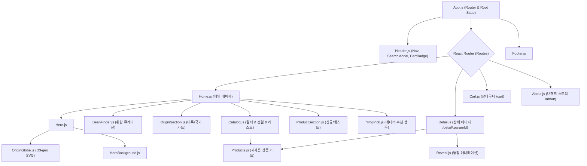
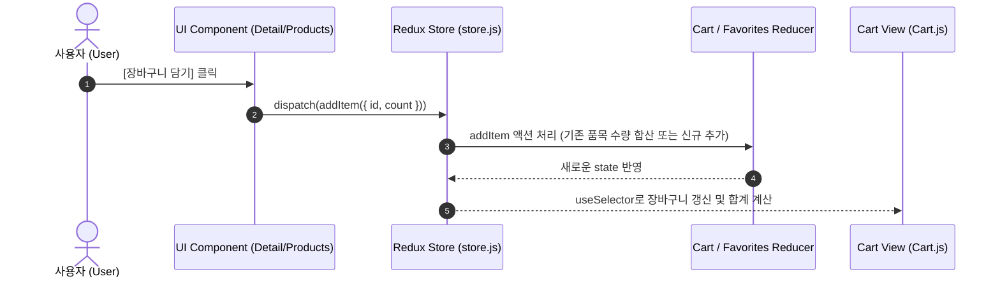

# 🌍 YMG BEANS (산지와 컵핑노트)
> **"한 알의 생두에서 시작되는 새로운 가능성"**  
> 세계 각국의 스페셜티 생두를 대화형 3D 지구본과 취향 큐레이션으로 탐색하는 React 기반 스페셜티 커피 이커머스 웹 플랫폼

<div align="center">


</div>

---

## 📑 목차 (Table of Contents)
1. [프로젝트 개요 (Overview)](#1-프로젝트-개요-overview)
2. [기획 배경 및 목적 (Background & Goals)](#2-기획-배경-및-목적-background--goals)
3. [주요 핵심 기능 (Key Features)](#3-주요-핵심-기능-key-features)
4. [시스템 아키텍처 및 데이터 흐름 (Architecture & Data Flow)](#4-시스템-아키텍처-및-데이터-흐름-architecture--data-flow)
5. [기술 스택 및 선정 이유 (Tech Stack & Rationale)](#5-기술-스택-및-선정-이유-tech-stack--rationale)
6. [UI/UX 및 화면 설계 (Screens & Interactions)](#6-uiux-및-화면-설계-screens--interactions)
7. [기술적 챌린지 및 해결 과정 (Technical Challenges & Troubleshooting)](#7-기술적-챌린지-및-해결-과정-technical-challenges--troubleshooting)
8. [프로젝트 구조 (Directory Structure)](#8-프로젝트-구조-directory-structure)
9. [설치 및 로컬 실행 가이드 (Getting Started)](#9-설치-및-로컬-실행-가이드-getting-started)
10. [배포 가이드 (Deployment Guide)](#10-배포-가이드-deployment-guide)
11. [📊 [PPT 제작용] 슬라이드 구성 및 발표 가이드 (Slide Deck Mapping)](#11--ppt-제작용-슬라이드-구성-및-발표-가이드-slide-deck-mapping)

---

## 1. 프로젝트 개요 (Overview)

**YMG BEANS**는 홈로스터, 바리스타, 스페셜티 커피 애호가를 위해 **산지(Terroir) 중심의 탐색 경험**과 **취향(Cup Profile) 기반의 큐레이션**을 제공하는 차세대 스페셜티 생두 큐레이션 쇼핑몰입니다.

일반적인 텍스트/그리드 중심의 쇼핑몰에서 벗어나, **D3.js 기반의 3D 회전 지구본 인터랙션**과 **향미 기반 생두 추천 엔진(Bean Finder)**을 탑재하여 커피가 생산된 대륙과 환경, 독특한 컵핑노트를 시각적·공간적으로 몰입감 있게 경험할 수 있도록 설계되었습니다.

- **프로젝트 명칭**: YMG Beans — 산지와 컵핑노트 (v4.0.0)
- **개발 환경**: React 18, Single Page Application (SPA)
- **핵심 키워드**: `#스페셜티생두` `#D3지구본인터랙션` `#ReduxToolkit` `#취향큐레이션` `#반응형웹`

---

## 2. 기획 배경 및 목적 (Background & Goals)

### 2.1 문제 정의 (Problem Definition)
* **산지 정보의 부재**: 커피 생두는 생산국의 고도, 토양, 기후, 가공 방식(Washed, Natural, Anaerobic 등)에 따라 맛이 결정되나, 기존 커머스는 단순 패키지 사진과 가격 위주로 나열되어 생두의 본질적 가치를 파악하기 어렵습니다.
* **복잡한 컵핑노트의 진입장벽**: 초보자나 일반 애호가에게 SCAA 기준의 복잡한 커핑 전문 용어는 생두 선택의 큰 장벽이 됩니다.

### 2.2 해결 방안 및 프로젝트 목표 (Solutions & Value Proposition)
1. **시각적 산지 탐험 (Visual Terroir)**: D3-geo 기반 정사영(Orthographic) 회전 지구본을 통해 19개 주요 커피 생산국을 지구본 상에서 직접 클릭하고 즉각적인 산지 스펙을 확인.
2. **직관적 플레이버 큐레이터 (Bean Finder)**: `고소하고 달콤한(Chocolate)`, `과일향(Fruity)`, `화사한 꽃향(Floral)`, `산뜻한 산미(Citrus)`, `묵직한 바디(Bold)` 등 5가지 직관적 감각 축으로 생두를 추천.
3. **고도화된 상태 관리와 반응형 이커머스**: Redux Toolkit을 통한 중앙집중식 장바구니/찜(Favorite) 관리, 다차원 필터링 및 정렬, 모바일 최적화 레이아웃 제공.

---

## 3. 주요 핵심 기능 (Key Features)

### 🌐 1. D3.js 대화형 3D 회전 지구본 (Interactive Origin Globe)
* **정사영(Orthographic) 수학적 투영**: `d3-geo`의 `geoOrthographic`, `geoGraticule10`을 활용해 왜곡 없는 3차원 입체 구형 지구본을 SVG로 렌더링.
* **부드러운 카메라 보간(Interpolation)**: 국가 선택 시 `requestAnimationFrame`과 3차 큐빅 이징(`1 - (1 - t)^3`), 경도 정규화(`normLon`)를 적용하여 지구본이 최단 경로로 회전.
* **접근성(Accessibility) 준수**: `prefers-reduced-motion` 미디어 쿼리를 감지해 모션 민감 사용자를 위한 즉각 전환 지원 및 키보드(Enter, Space) 포커스 내비게이션 완비.

### ☕ 2. 취향 기반 생두 탐색기 (Bean Finder)
* 5가지 시그니처 향미 프로필(초콜릿/너티, 베리/과일, 플로럴/티, 시트러스, 풀바디) 선택 UI.
* 각 취향에 부합하는 생두 목록 실시간 매칭 및 원클릭 카탈로그 필터 연동.

### 🔍 3. 다차원 스마트 필터링 & 검색 카탈로그 (Catalog & Filter)
* **대륙별 탭**: 아프리카, 중남미, 아시아·대양주, 디카페인, 무산소 발효 등.
* **복합 필터**: 국가별, 가공 방식별(Washed, Natural, Honey, Anaerobic, Decaf 등), 찜한 상품 보기.
* **동적 정렬**: 추천순, 낮은 가격순, 높은 가격순, 이름순 정렬.
* **라이브 자동완성 검색**: 헤더 검색창에서 실시간 키워드 매칭 추천 목록 제공.

### 📄 4. 고도화된 생두 상세 페이지 (Detail Page)
* **탭 UI**: 상세 스펙(고도, 품종, 가공, 수확기 등), 산지 스토리, 컵핑노트 탭 전환.
* **수량 선택 및 실시간 금액 계산**: 수량 증감(1~99 제한) 및 합계액 즉시 반영.
* **연관 생두 추천**: 동일 산지 및 유사 프로필 생두 자동 큐레이션.
* **다이렉트 액션**: 장바구니 담기, 찜(위시리스트) 토글, 모달 알림.

### 🛒 5. Redux Toolkit 기반 상태 관리 (Cart & Favorites)
* **장바구니 Slice**: 수량 조절, 단일 품목 삭제, 전체 비우기, 상품명 가나다순 정렬.
* **위시리스트(찜) Slice**: 토글 방식으로 관심 상품 저장 및 카탈로그 필터 연계.
* **데이터 무결성 유지**: 로컬 상태에 최소 식별자(`id`, `count`)만 보관하고, 렌더링 시 최신 JSON 마스터 데이터와 조인하여 데이터 불일치 원천 차단.

---

## 4. 시스템 아키텍처 및 데이터 흐름 (Architecture & Data Flow)

### 4.1 컴포넌트 계층 구조 (Component Hierarchy)


### 4.2 Redux 상태 흐름 (State Flow)


---

## 5. 기술 스택 및 선정 이유 (Tech Stack & Rationale)

| 분류 | 기술 / 라이브러리 | 버전 | 선정 이유 및 역할 |
| :--- | :--- | :--- | :--- |
| **Core** | **React** | `18.2.0` | 컴포넌트 재사용성 극대화, 선언적 UI 렌더링, Virtual DOM 최적화 |
| **State** | **Redux Toolkit** | `2.12.0` | 장바구니 및 찜 목록의 전역 상태 일원화, 보일러플레이트 코드 최소화 |
| **Routing** | **React Router DOM** | `6.30.1` | SPA 환경의 동적 파라미터 라우팅(`/detail/:paramId`), 딥링킹 및 히스토리 관리 |
| **Data Viz** | **D3-geo** | `3.1.1` | 3차원 구형 정사영(Orthographic) 수학적 계산 및 SVG 지리 데이터 렌더링 |
| **Icons** | **Lucide React** | `0.468.0` | 일관된 모던 UI 아이콘 및 트리쉐이킹(Tree-shaking) 최적화 |
| **Data Format** | **JSON** | Native | 18개 생두 및 19개 생산국, GeoJSON 세계 지도의 관계형 정적 데이터베이스 구조화 |
| **Styling** | **Vanilla CSS** | Standard | CSS 변수(Variables), Flexbox/Grid 기반의 가볍고 빠른 반응형 스타일링 |

---

## 6. UI/UX 및 화면 설계 (Screens & Interactions)

| 화면 | 주요 구성 요소 | 사용자 경험(UX) 포인트 |
| :--- | :--- | :--- |
| **1. 메인 Hero & 지구본** | 3D 회전 지구본, 국가 정보 카드, 산지별 생두 카운트 | 마우스 클릭 및 휠로 세계 산지를 둘러보며 대륙별 스페셜티 특성을 직관적으로 파악 |
| **2. Bean Finder** | 5가지 맛/향미 카드, 추천 결과 프리뷰 | 복잡한 커피 지식 없이도 개인의 취향 키워드를 클릭하여 즉시 맞춤 생두를 추천받음 |
| **3. Catalog & Shop** | 대륙 탭, 국가 드롭다운, 가공방식 필터, 가격 정렬 | 필터 변경 시 깜빡임 없는 인스턴트 필터링과 '더보기(Show More)' 페이징 |
| **4. Product Detail** | 갤러리, 컵핑노트 태그, 스펙 아코디언, 수량 증감기 | 생두 고도, 가공법, 품종, 테이스팅 노트의 상세한 정보 제공 및 위시리스트 연동 |
| **5. Cart (장바구니)** | 품목별 수량 제어, 가나다순 정렬, 참고 합계 계산 | 실시간 수량 증감 및 가격 미정 항목 예외 처리, 비우기 기능 제공 |
| **6. About (브랜드)** | 브랜드 철학 매니페스토, 포토 에세이, 가치관 소개 | YMG BEANS의 스페셜티 큐레이션 가치와 산지 다이렉트 철학 전달 |

---

## 7. 기술적 챌린지 및 해결 과정 (Technical Challenges & Troubleshooting)

### 💡 Challenge 1: D3-geo 정사영 회전 시 경도 불연속 점프 현상
* **문제점**: 지구본 회전 시 경도(-180° ~ 180°)의 경계선을 지날 때 각도가 360도 급변하며 지구본이 반대 방향으로 비정상 회전하는 현상 발생.
* **해결책**:
  ```javascript
  // 경도 정규화 수식을 통해 최단 회전 경로 산출
  const normLon = (value) => ((value + 540) % 360) - 180;
  ```
  `normLon` 유틸리티 함수와 `requestAnimationFrame` 큐빅 이징 함수를 결합하여 어느 국가를 클릭해도 항상 가장 가까운 방향으로 부드럽게 감속 회전하도록 구현.

### 💡 Challenge 2: 상태 분리와 데이터 동기화 최적화
* **문제점**: 장바구니에 상품 객체 전체를 복사해 저장할 경우, JSON 데이터의 가격이나 상세 정보가 변경되었을 때 데이터 불일치(Inconsistency) 발생 위험.
* **해결책**: Redux 상태에는 `{ id, count }` 원자 데이터만 저장하고, 화면 렌더링 시점에 최신 마스터 JSON(`beans.js`)과 ID 매핑(`find`)을 수행하여 **Single Source of Truth(단일 진실 공급원)** 원칙 확립.

### 💡 Challenge 3: Hash 링크 스크롤 및 SPA 새로고침 대응
* **문제점**: 상세 페이지나 장바구니에서 메인 샵 섹션(`#shop`)으로 이동 시 단일 페이지 라우팅으로 인해 스크롤 위치가 이동하지 않는 문제.
* **해결책**: `App.js`의 `useEffect`에서 `location` 변경을 감지하고, `location.hash`가 존재할 경우 대상 DOM 요소를 찾아 `scrollIntoView()`를 부드럽게 실행하도록 리스너 구축.

---

## 8. 프로젝트 구조 (Directory Structure)

```text
ymgbeans-latest-source/
├── public/                     # 정적 에셋 (HTML, 로고, 브랜드 이미지, 파비콘)
│   ├── brand/                  # 브랜드 로고 에셋
│   ├── images/                 # 생두 연출 컷 및 국가별 대표 사진 (WebP)
│   └── index.html              # HTML 템플릿 (SEO 메타태그)
├── src/
│   ├── components/             # UI 프레젠테이션 컴포넌트
│   │   ├── About.js            # 브랜드 스토리 및 매니페스토
│   │   ├── BeanFinder.js       # 취향별 맞춤 생두 탐색 컴포넌트
│   │   ├── Cart.js             # 장바구니 관리 페이지
│   │   ├── Catalog.js          # 필터링, 정렬, 상품 리스트 뷰
│   │   ├── Detail.js           # 상품 상세 스펙 & 컵핑노트 뷰
│   │   ├── Footer.js           # 사이트 하단 정보 및 내비게이션
│   │   ├── Header.js           # 글로벌 헤더, 라이브 검색, 장바구니 배지
│   │   ├── Hero.js             # 메인 비주얼 및 지구본 인터랙션 컨트롤러
│   │   ├── HeroBackground.js   # 배경 앰비언트 비주얼
│   │   ├── Home.js             # 메인 통합 랜딩 페이지
│   │   ├── Modal.js            # 모달 팝업 컴포넌트
│   │   ├── OriginGlobe.js      # D3-geo SVG 3D 회전 지구본 컴포넌트
│   │   ├── OriginSection.js    # 산지별 스토리 섹션
│   │   ├── ProductSection.js   # 기획전 (NEW / BEST 컬렉션)
│   │   ├── Products.js         # 재사용 가능한 상품 카드 단위
│   │   ├── Reveal.js           # 스크롤 인터랙션 래퍼
│   │   └── YmgPick.js          # 이달의 추천 생두 큐레이션 카드
│   ├── db/                     # 정적 데이터베이스 모듈
│   │   ├── beans.js            # 이미지 경로 보정 및 가공 상품 데이터
│   │   ├── categories.js       # 대륙 카테고리 및 필터 기본값
│   │   ├── filterProducts.js   # 복합 필터링 & 다중 정렬 알고리즘
│   │   ├── flavors.js          # 플레이버 휠 및 센서리 텍스트 매핑
│   │   ├── origins.js          # 산지 좌표 및 프로필 통합 데이터
│   │   ├── products.json       # 18개 스페셜티 생두 마스터 데이터
│   │   ├── regions.json        # 19개 생산국 및 대륙 분류 데이터
│   │   └── world.json          # 정사영 지구본용 GeoJSON 세계 지도 데이터
│   ├── store.js                # Redux Toolkit 설정 (Cart / Favorites Slice)
│   ├── App.js                  # 라우팅 테이블 및 최상위 이벤트 핸들러
│   ├── App.css                 # 핵심 레이아웃 및 컴포넌트 스타일
│   ├── index.css               # 글로벌 리셋, 타이포그래피, 반응형 미디어쿼리
│   └── index.js                # Redux Provider, BrowserRouter 마운트 진입점
├── package.json                # 프로젝트 의존성 및 스크립트 명세
├── start-windows.cmd           # Windows 원클릭 자동 실행 스크립트
└── README.md                   # 프로젝트 메인 문서
```

---

## 9. 설치 및 로컬 실행 가이드 (Getting Started)

### 9.1 요구 사항 (Prerequisites)
* Node.js v16.0.0 이상
* npm v8.0.0 이상

### 9.2 원클릭 실행 (Windows 사용자 전용)
프로젝트 루트 폴더의 `start-windows.cmd`를 더블 클릭하면 의존성 검사, 설치(`npm ci`), 로컬 서버 구동(`npm start`)이 자동으로 진행됩니다.

### 9.3 수동 명령어 실행
```bash
# 1. 저장소 복제 (또는 작업 디렉토리 이동)
cd ymgbeans-latest-source

# 2. 의존성 패키지 설치
npm ci

# 3. 로컬 개발 서버 시작 (http://localhost:3000)
npm start

# 4. 프로덕션 배포용 정적 번들 빌드
npm run build
```

---

## 10. 배포 가이드 (Deployment Guide)

### GitHub Pages 배포 시 체크리스트
본 프로젝트는 Single Page Application(SPA)이며 `react-router-dom`의 `BrowserRouter`를 사용합니다. GitHub Pages와 같은 정적 호스팅 서비스에 배포할 때는 아래 설정이 권장됩니다.

1. **`package.json` homepage 설정 확인**:
   ```json
   "homepage": "https://<username>.github.io/<repository-name>"
   ```
2. **SPA 새로고침(404 에러) 방지**:
   * `public/index.html`을 복사하여 `public/404.html`로 배치하거나, GitHub Pages SPA 리다이렉션 스크립트를 적용합니다.
3. **배포 스크립트 실행**:
   ```bash
   npm install gh-pages --save-dev
   npm run build
   npx gh-pages -d build
   ```

---

## 11. 📊 [PPT 제작용] 슬라이드 구성 및 발표 가이드 (Slide Deck Mapping)

> **💡 TIP**: 본 섹션은 추후 **GitHub 배포용 포트폴리오/프로젝트 발표 PPT**를 제작할 때 슬라이드 장표별로 그대로 복사하여 구성할 수 있도록 최적화된 청사진(Blueprint)입니다.

| 슬라이드 번호 | 슬라이드 제목 | 핵심 메시지 및 포함 콘텐츠 | 추천 시각 자료 |
| :---: | :--- | :--- | :--- |
| **Slide 1** | **Title & Introduction** | • 프로젝트명: YMG BEANS<br>• 서브타이틀: 산지와 컵핑노트 중심의 스페셜티 생두 큐레이션 플랫폼<br>• 발표자 / 개발 기간 / 버전 (v4.0.0) | 플랫폼 대표 로고, 메인 키 비주얼 |
| **Slide 2** | **Background & Problem** | • 기존 커피 커머스의 한계: 불친절한 텍스트 나열, 산지 정보 부재<br>• 사용자 페인포인트: 어려운 커핑 용어, 내 취향 생두를 찾기 어려움<br>• 기획 목적: 산지 중심의 인터랙티브 탐색과 감각적 취향 추천 | 기존 UI vs YMG Beans 비교 다이어그램 |
| **Slide 3** | **Target Persona & Value** | • 타깃 유저: 스페셜티 홈로스터, 바리스타, 원두 탐험가<br>• 핵심 가치: **Spatial Terroir**(공간적 산지 체험) + **Flavor Journey**(취향 큐레이션) | 유저 페르소나 카드, 핵심 가치 인포그래픽 |
| **Slide 4** | **Key Feature 1: 3D Origin Globe** | • D3-geo 기반 정사영(Orthographic) 회전 지구본<br>• 19개 생산국 실시간 포커싱 및 큐빅 이징 애니메이션<br>• SVG 기반 가벼운 렌더링 및 모션 접근성 준수 | 지구본 회전 시연 GIF / 스크린샷 |
| **Slide 5** | **Key Feature 2: Bean Finder** | • 5가지 시그니처 향미 프로필(초콜릿, 과일, 꽃향, 시트러스, 바디)<br>• 원클릭 매칭 및 탐색 연동으로 초보자 진입장벽 해소 | 플레이버 휠 및 Bean Finder 카드 UI |
| **Slide 6** | **Key Feature 3: Catalog & Detail** | • 대륙/가공방식/찜 기반의 다차원 스마트 필터링<br>• 상세 스펙(고도, 품종, 수확기) 및 연관 생두 큐레이션<br>• 실시간 수량 제어 및 탭 전환 시스템 | 카탈로그 필터 및 상세 페이지 스크린샷 |
| **Slide 7** | **System Architecture & Data** | • 컴포넌트 계층 트리 구조 (App → Home/Detail/Cart/About)<br>• 정규화된 JSON 데이터베이스 구조 (origins, products, regions)<br>• Single Source of Truth 원칙 준수 | 본 README의 4.1 Mermaid 컴포넌트 다이어그램 |
| **Slide 8** | **State Management (Redux)** | • Redux Toolkit 슬라이스 설계 (`cart`, `favorites`)<br>• 상태와 마스터 데이터 조인을 통한 데이터 무결성 보장<br>• 실시간 장바구니 수량 증감, 정렬, 합계 계산 흐름 | 본 README의 4.2 시퀀스 다이어그램 |
| **Slide 9** | **Tech Stack & Decision** | • React 18 (SPA, 컴포넌트 재사용)<br>• Redux Toolkit (전역 상태 일원화)<br>• D3-geo (가벼운 수학적 SVG 지구본 구현)<br>• React Router v6 (동적 라우팅) | 기술 스택 뱃지 및 선정 이유 비교표 |
| **Slide 10** | **Technical Challenges & Solved** | • 경도 360° 경계 회전 시 점프 버그 해결 (`normLon` 수학식)<br>• requestAnimationFrame 부드러운 감속 이징 최적화<br>• 새로고침 및 SPA 해시 앵커 스크롤 대응 | 트러블슈팅 코드 스니펫 및 전/후 비교 |
| **Slide 11** | **Future Roadmap** | • 1단계: 실제 PG사 결제 API 및 회원 시스템 연동<br>• 2단계: 유저 직접 참여 커핑노트 작성 & 레이더 차트 시각화<br>• 3단계: 로스팅 프로파일 공유 커뮤니티 확장 | 3단계 로드맵 타임라인 그래픽 |
| **Slide 12** | **Q&A & Thank You** | • GitHub 저장소 링크 및 라이브 데모 URL<br>• 질의응답 및 마무리 인사 | GitHub QR 코드, 이메일, 링크 |

---

## 12. 라이선스 및 크레딧 (License & Credits)
* 본 프로젝트는 교육 및 포트폴리오 목적으로 제작된 오픈소스 프로젝트입니다.
* 사진 및 에셋 저작권은 각 원작자에게 있으며, 상세 크레딧은 `src/db/photoCredits.json`을 참조하십시오.
